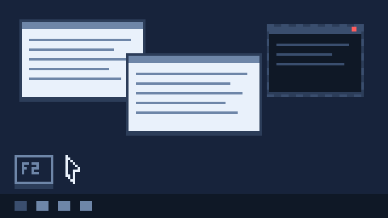

# Laocoön · Sonda de janelas

[中文](../README.md) · [English](README.en.md) · [Русский](README.ru.md) · [Français](README.fr.md) · [Español](README.es.md) · [العربية](README.ar.md) · [Deutsch](README.de.md) · **Português** · [日本語](README.ja.md) · [한국어](README.ko.md) · [हिन्दी](README.hi.md) · [Italiano](README.it.md)

> Diante de Troia, todos queriam arrastar aquele cavalo de madeira para dentro da cidade. Só Laocoonte se recusou.
> Ele cravou a lança na barriga do cavalo — e ouviu armas se chocando lá dentro.
>
> Esta ferramenta faz o mesmo: **espetar uma janela e ouvir o que ela esconde.**

## Um pouco de contexto: ele não salvou Troia

Laocoonte era sacerdote de Troia. Desconfiou do cavalo de madeira, cravou a lança no ventre e insistiu que a cidade o queimasse.

Não convenceu ninguém. Os deuses estavam do lado dos gregos: duas serpentes marinhas saíram da água e o sufocaram com os dois filhos na praia.
Os troianos viram nisso a prova de que ele ofendera o céu, e recolheram o cavalo com mais tranquilidade. Naquela noite os soldados escondidos abriram os portões, e Troia caiu.

É a parte menos romântica da história: **ele estava certo, mas não convenceu ninguém nem viveu para ver a confirmação.**

É aí que esta ferramenta se posiciona. Ela não julga por você nem tira conclusões. Só põe sobre a mesa o que dá para ler de uma janela e do seu processo: caminhos, assinaturas, módulos carregados, controles filhos e alguns pontos que lhe parecem suspeitos.

O que é de fato suspeito, se convém agir, se é caso de reportar, se foi alarme falso — a decisão é sua. Ela também pode errar: os "indícios" são heurísticas, não veredictos.

O relatório é uma lista de fatos, não uma sentença. Olhe com atenção e aja com cautela.

<p align="center">
  
</p>

Você vê uma janela que não reconhece — talvez algo indesejado. Pressione `F2`, leve a mira até ela, clique. Ele despeja tudo o que dá para extrair daquela janela e do processo por trás dela.

- Um único arquivo `Laocoon.exe`, cerca de **384 KB**
- Zero dependências de terceiros: apenas o .NET Framework 4.x que já vem com o Windows (Win10 / Win11, nada para instalar)
- Sem escrita no registro, sem arquivo de configuração, sem agente em segundo plano (descompacta, executa — nada fica no disco)
- A única conexão é uma verificação de versão ao abrir: lê um manifesto público no GitHub e não envia nada sobre a máquina; `--noupdate` desliga
- Doze idiomas embutidos: **中文 / English / Русский / Français / Español / العربية / Deutsch / Português / 日本語 / 한국어 / हिन्दी / Italiano**

> O nome do arquivo é `Laocoon.exe`, em ASCII; o título da janela mantém o trema — `Laocoön`.
> Assim caminhos, linhas de comando, anexos de e-mail e CI nunca tropeçam em caracteres não ASCII.

---

## Como usar

<p align="center">
  
</p>

1. Dê dois cliques em `Laocoon.exe` (para o máximo de informação: **clique direito → Executar como administrador**)
2. Pressione `F2` — o cursor vira uma cruz
3. Passe sobre a janela desejada: uma moldura azul a envolve e um pequeno HUD preto flutua ao lado, mostrando classe / título / PID / janela pai em tempo real
4. **Clique esquerdo** fixa e captura; **clique direito** ou **Esc** cancela
5. O relatório completo aparece na hora: janela, processo, arquivo, assinatura, janelas ocultas e controles filhos, tudo de uma vez

A captura é única: nada se atualiza por temporizador, nada fica em segundo plano vigiando você. Feche a janela e não sobra nada — exceto o arquivo que você mesmo gravou com «Salvar relatório».

## Idiomas da interface

**12 idiomas** embutidos, trocáveis a qualquer momento pela lista no canto inferior direito, **sem reiniciar**:

| Código | Idioma | Título da janela |
|---|---|---|
| `zh` | 中文 | Laocoön 拉奥孔 · 窗口探针 |
| `en` | English | Laocoön · Window Probe |
| `ru` | Русский | Laocoön · Зонд окон |
| `fr` | Français | Laocoön · Sonde de fenêtres |
| `es` | Español | Laocoön · Sonda de ventanas |
| `ar` | العربية | Laocoön · فاحص النوافذ |
| `de` | Deutsch | Laocoön · Fenster-Sonde |
| `pt` | Português | Laocoön · Sonda de janelas |
| `ja` | 日本語 | Laocoön · ウィンドウ探針 |
| `ko` | 한국어 | Laocoön · 창 프로브 |
| `hi` | हिन्दी | Laocoön · विंडो प्रोब |
| `it` | Italiano | Laocoön · Sonda finestre |

Por que esses doze: os idiomas dos cinco membros permanentes do Conselho de Segurança da ONU como base, mais **árabe** (o único idioma de trabalho da ONU que falta nessa lista), **alemão / português / japonês / coreano** (grandes economias e ecossistemas de software), **hindi** (o maior mercado monolíngue em população) e **italiano** (cultura europeia). Turco, indonésio, vietnamita e polonês ficaram de fora — o ponto de extensão está aberto: acrescentar um idioma é acrescentar uma tabela em `Lang.cs`.

A lista é **em níveis**: no topo os cinco idiomas da ONU, um separador e depois os das grandes economias desenvolvidas (alemão / japonês / coreano / italiano / português); abaixo, a entrada «Mais idiomas…» abre um pequeno painel em grade com o restante numa única tela — o árabe e o híndi moram aí agora. Os idiomas do dia a dia não pedem rolagem, e qualquer idioma adicionado depois cai sozinho nesse painel.

Na primeira execução o idioma é decidido nesta ordem:

```
--lang=xx na linha de comando  >  idioma do sistema  >  inglês
```

Ou seja, um sistema chinês abre em chinês; sistemas russo / francês / espanhol / árabe / alemão / português / japonês / coreano / hindi / italiano mostram o seu; o resto cai no inglês (variantes regionais como `pt-BR`, `zh-Hant`, `ar-EG` são reconhecidas). A troca vale só para esta execução — nada é salvo; para fixar o idioma, inicie `Laocoon.exe --lang=ru` (ou crie um atalho com esse argumento).

Não é só a interface que é traduzida: **o corpo do relatório** também — rótulos, títulos de seção e avisos heurísticos («o executável está na pasta temporária», «o processo tem N janelas de nível superior ocultas») são gerados no idioma atual.

### Como o árabe (da direita para a esquerda) é tratado

Árabe não é «trocar a tabela de strings». Nos testes apareceram três armadilhas:

1. **Interface espelhada**: a janela inteira é invertida com `RightToLeftLayout`, a barra de ferramentas corre da direita para a esquerda e o botão principal fica na ponta direita.
2. **O relatório não é espelhado**: ele é cheio de caminhos, hashes e nomes de classe. Espelhar inverte o começo e o fim de cada linha, então a caixa de relatório fica sempre da esquerda para a direita. Só a **página de boas-vindas** (texto corrido) é alinhada à direita em árabe.
3. **Os dois-pontos saltam para a esquerda do rótulo**: o motor BiDi do GDI considera que os dois-pontos em «rótulo árabe + `:` + valor latino» pertencem ao trecho RTL da direita e desenha `0 :المقبضx0001048E`. A solução é um LRM de largura zero (U+200E) dos dois lados dos dois-pontos para forçar a direção, com o mesmo isolamento nos argumentos de formatação (datas, PID, nomes de classe) — senão uma data vira `04:28:37 08-11-2026`. O experimento comparativo com todas as variantes ficou no diagnóstico `--biditest`, para poder ser repetido numa futura reescrita.

O **devanágari** (hindi) também não tem largura fixa, como o árabe: «preencher com espaços para alinhar» só piora. Por isso esses dois idiomas passam o relatório para o formato `rótulo: valor` — melhor sem alinhamento do que com alinhamento falso.
Árabe, hindi, japonês e coreano usam cada um a fonte que o Windows traz (Segoe UI / Nirmala UI / Yu Gothic UI / Malgun Gothic); se faltar, há retorno automático, sem quadrados nem exceções.

## O que é coletado

| Categoria | Conteúdo |
|---|---|
| Janela | Handle, classe, título, bits de estilo (decodificados em nomes `WS_*` / `WS_EX_*`), retângulo, área cliente, visível / minimizada, **sempre no topo**, **janela de ferramenta**, **oculta pelo DWM**, janela proprietária |
| Controle atingido | Até o controle filho exato: classe, ID, texto, caminho da janela raiz até ele |
| Processo | PID / TID, caminho completo, **linha de comando**, pai (nome + PID), arquitetura (x86 / x64 / WOW64), **elevação**, sessão, hora de início |
| Arquivo | Tamanho, criação / modificação, **MD5 / SHA1 / SHA256**, empresa, produto, descrição, versão, copyright |
| Assinatura | Se existe assinatura embutida, signatário, emissor, validade, resultado da cadeia |
| Módulos | Caminhos completos de todas as DLL carregadas pelo processo |
| Janelas do processo | **Todas** as janelas de nível superior desse processo, inclusive ocultas (marcadas `[oculta]`) — a janela de fundo de um programa indesejado não se esconde aqui |
| Árvore de controles | A árvore completa de controles filhos da janela alvo: recuo, tamanho, ID, texto |
| Indícios de suspeita | Heurísticas: está em Temp / Downloads / AppData, sem assinatura, sem nome de empresa, sempre no topo, número de janelas ocultas, arquivo criado nos últimos 7 dias etc. (**indícios, não veredito**) |

O relatório inteiro é texto puro: colunas alinhadas, seções separadas; dá para selecionar e copiar, ou usar «Salvar relatório» para gravar um `.txt` em UTF-8. Para conferir um arquivo a fundo, copie o `sha256` para qualquer serviço de sua confiança — esta ferramenta só captura localmente e não envia nada (a única conexão é a verificação de versão, veja «Atualização automática»).

## Atualização automática

Ninguém deveria precisar procurar a página de download de uma versão nova. Poucos segundos depois de abrir, o programa pergunta uma vez ao GitHub se existe algo mais recente que `1.6.0`.

- Lê um único manifesto de texto público (`releases/latest/download/latest.txt`): versão, URL de download, SHA-256, tamanho, data e uma linha de notas
- **Não envia** nada sobre a máquina: sem identificador, sem estatística, sem «quem está usando»
- Uma versão nova **não abre janela**: surge um botão «Atualizar x.y.z» na barra e a barra de status diz uma frase. Se ignorar, ele não insiste
- O download só começa no clique: barra de progresso com a fase atual e o SHA-256 é conferido na hora — se não bater, o arquivo é apagado em vez de instalar meio programa
- Depois de conferir, escreve um pequeno script de troca, fecha, substitui o exe e abre de novo. Ninguém precisa ficar olhando
- Se a troca falhar (antivírus ainda segurando o arquivo, pasta somente leitura), o script reabre a versão antiga e a página de download — você nunca fica diante de um programa que sumiu
- Uma verificação que falha (offline, bloqueada, proxy da empresa) é ignorada em silêncio; o resto continua igual
- `--noupdate` desliga a verificação; `--feed=` aponta para um espelho interno ou um arquivo local

O manifesto e o exe saem da mesma execução de CI e o hash é calculado ali, então não existe brecha de «o manifesto diz A e o download entrega B».


## Limitações conhecidas

- **Assinatura digital**: só a assinatura embutida no PE é verificada. Arquivos do próprio Windows (como `notepad.exe`) são assinados por catálogo, então aparece «nenhuma assinatura embutida» — é normal.
- Sem direitos de administrador, processos elevados ou protegidos não fornecem caminho / módulos / linha de comando (aparece «acesso negado»); os demais campos continuam funcionando.
- `WM_GETTEXT` para texto de controles aplica limite de 60 ms em janelas que não respondem (`SMTO_ABORTIFHUNG`), para nunca travar a interface — por isso, em raras janelas travadas, não há texto.
- A árvore de controles para em 240 itens e a lista de módulos em 400; o excedente é marcado como truncado.
- O cálculo de hash para em 512 MB e é ignorado acima disso (para não esperar uma eternidade).
- O idioma segue o sistema; fora dos doze, usa-se inglês. As traduções são escritas à mão, e termos próprios do Windows (`WS_*` / `WS_EX_*`, `DWM Cloaked`) ficam de propósito em inglês, para que cada idioma não invente seu vocabulário.
- A interface árabe é espelhada, mas **o relatório fica sempre da esquerda para a direita** — são dados técnicos, espelhados ficam ilegíveis. É proposital, não tradução pela metade.

## Histórico de versões

- **1.6.1** — Lista de idiomas em níveis: os cinco da ONU no topo, depois as grandes economias desenvolvidas, e «Mais idiomas…» abre uma grade de uma tela com o restante; novo diagnóstico `--langmenu`
- **1.6.0** — Atualização automática: ao abrir, compara em segundo plano o manifesto no GitHub; havendo versão mais nova aparece o botão «Atualizar» — o clique baixa, confere o SHA-256, troca o exe e reinicia. Verificação que falha passa em silêncio, `--noupdate` desliga
- **1.5.0** — Nova janela «Sobre» (`F1` ou o último botão da barra): duas animações em pixel, uma sobre a origem do nome e outra sobre o que a ferramenta faz; ambas vêm dentro do exe, nada extra para baixar
- **1.4.4** — Corrigido um encerramento inesperado ocasional ao trocar de idioma rapidamente com a seta pressionada: a recriação dos identificadores de janela já não acontece dentro do tratamento de mensagens da lista, e o espelhamento RTL espera que as teclas sejam soltas
- **1.4.3** — Fim do `Laocoon.ini`: o idioma segue o sistema, a troca manual vale só para esta execução e o programa não deixa arquivo algum
- **1.4.2** — Os três arquivos de idiomas unidos em um único `Lang.cs`; arrumação de código, sem mudanças de interface ou texto
- **1.4.1** — Corrigido: o seletor de idioma perdia o foco ao mudar para o árabe ou voltar, quebrando a troca pelo teclado sem aviso; o foco volta ao seletor
- **1.4** — Novo ícone em pixel art: 8 tamanhos de 16 a 256 embutidos no exe, iguais na barra de título, na barra de tarefas e no explorador
- **1.3** — saída JSON e aba JSON removidas; apenas relatório em texto
- **1.2** — verificação na nuvem removida (modelo de URL + «abrir no navegador»); só captura local; o `Laocoon.ini` guarda apenas o idioma; README em 12 idiomas
- **1.1** — interface e relatório em 12 idiomas; tratamento RTL dedicado ao árabe
- **1.0** — primeira versão: mirar, capturar, relatório

## Compilar por conta própria

É preciso o SDK do .NET (8 ou mais novo). Dê dois cliques em `build.bat`, ou:

```bat
dotnet build src\Laocoon.csproj -c Release
```

O resultado fica em `src\bin\Release\net48\Laocoon.exe`.

> O `build.bat` aponta `TEMP` para uma pasta local `.tmp` de propósito: em algumas máquinas a pasta temporária do sistema não aceita gravação e a compilação falha na hora.

## Código-fonte

- `src/Laocoon.cs` — o programa, cerca de 3191 linhas, só P/Invoke de Win32, nenhum pacote NuGet
- `src/Lang.cs` — núcleo de idiomas (enumeração, detecção, fonte, largura, busca, retorno) e as doze tabelas num único arquivo, cerca de 2611 linhas
- `src/Update.cs` — o módulo de atualização: comparação de versões, leitura do manifesto, download com verificação SHA-256, script de autosubstituição e janela de atualização, cerca de 1195 linhas
- `src/Laocoon.ico` — o próprio ícone em pixel art (8 tamanhos, 16 a 256), gerado de uma grade 16×16 por `tools/make_icon.py`
- `docs/img/*.gif` — as duas animações pixel deste README, desenhadas quadro a quadro por `tools/make_gifs.py` (8 cores, grelha 160×90, ampliação inteira)

Cada tabela tem 159 chaves, todas compiladas dentro do exe. Sem `.resources`, sem satellite assemblies: roda em qualquer máquina Win10/11 sem «pacote de idioma ausente, voltando ao inglês».

Pontos de entrada principais:
- `Probe.HitTest` — percorre ele mesmo as janelas de nível superior na ordem z (não `WindowFromPoint`, para nunca acertar a própria camada)
- `Probe.DeepestAt` — desce com `ChildWindowFromPointEx` até o controle mais interno
- `Probe.Collect` — reúne janela / processo / arquivo / assinatura / módulos / janelas irmãs / árvore de controles
- `FrameForm` / `HudForm` — a moldura azul transparente e o HUD que acompanha durante a mira (ambos `WS_EX_TRANSPARENT | WS_EX_NOACTIVATE`, não capturam o mouse)
- `L.T` / `L.F` — busca de string e formatação com marcadores; chave ausente cai no inglês em vez de ficar em branco

## Opções de diagnóstico (para mexer no código)

```
Laocoon.exe --selftest out.txt     capturar a janela do console, imprimir o relatório e gravá-lo em arquivo
Laocoon.exe --aimtest              autoteste de hit-testing e da camada de mira
Laocoon.exe --i18ncheck            conferir os 12 idiomas: chaves, largura de coluna, fontes, direção
Laocoon.exe --langswitch           percorrer todos os idiomas e verificar interface e relatório
Laocoon.exe --focustest f.log [shot.png]  percorrer os 12 idiomas e verificar se o seletor mantém o foco
Laocoon.exe --langstress 300 [log] [--rtl] simula a repetição das setas: recriação de identificadores e recursos
Laocoon.exe --biditest out.png     comparativo de 8 layouts bidi (árabe + dados latinos)
Laocoon.exe --lang=ru              iniciar em um idioma específico (não grava no ini)
Laocoon.exe --uishot out.png --lang=ar            renderizar a interface em PNG
Laocoon.exe --uishot out.png --lang=ar --welcome  apenas a página de boas-vindas
Laocoon.exe --uishot out.png --lang=ar --screen   capturar a tela (DrawToBitmap simula seleção em RTL)
Laocoon.exe --aboutshot out.png [--lang=xx]  renderizar a janela «Sobre» (as animações avançam alguns quadros)
Laocoon.exe --langmenu out.png [--lang=xx]  capturar a lista de idiomas aberta e o painel de segundo nível
Laocoon.exe --updatecheck [url|caminho]  rodar a verificação real e imprimir a comparação
Laocoon.exe --updatefetch url out.exe  baixar e conferir; dizer se o sha256 bate
Laocoon.exe --updateplan new.exe old.exe [page]  escrever só o script de troca, para revisar caminhos e escapes
Laocoon.exe --updateshot out.png [--lang=xx] [--state=dl|fail]  renderizar a janela de atualização
```

Combinado com `--lang=`, o `--uishot` renderiza as doze interfaces de uma vez para conferência visual.
